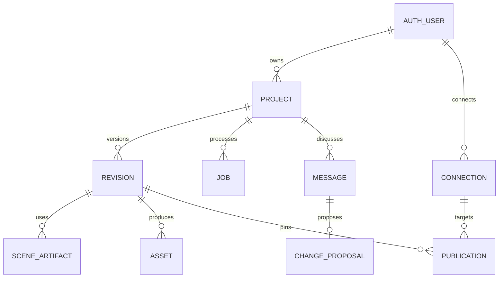

# Sochitra — Database Design

Version: 1.0 draft · 2 November 2026  
Database: MongoDB Atlas  
Related: [Architecture](SYSTEM_ARCHITECTURE.md) · [API design](API_DESIGN.md)

## 1. Principles

MongoDB is the authoritative state store; Cloudinary holds media files. Use the native MongoDB driver for application repositories and Better Auth's supported MongoDB adapter for authentication. Reuse a cached connection pool in the Node.js runtime rather than creating a new client per request.

Application IDs use ObjectId internally and strings at HTTP/event boundaries. Better Auth IDs follow the adapter's configured representation; `ownerId` consistently stores that auth user identifier. Do not assume it is an ObjectId. All timestamps are BSON Dates in UTC; schedules additionally store the user's IANA timezone.

All application documents include `schemaVersion`, `createdAt`, and `updatedAt`. Mutable aggregate roots also include an integer `version`. Ready revisions and their assets are immutable. Project queries always include `ownerId`.

## 2. Relationships

MongoDB does not enforce foreign keys. Repositories validate ownership, existence, and reference state before writes. Cross-record invariants use transactions where necessary; provider calls always happen outside transactions.

## 3. Collections

### Authentication collections

Better Auth owns its user, account, session, and verification records. Use its configured collection names and required indexes. Do not hand-design incompatible replacements or store application provider secrets in auth profiles. Team approval initially uses a server-side email allowlist and verified identity; no team or subscription collection is required.

### `projects`

Fields: `_id`, `ownerId`, `title`, `brief {topic, notes, language, audience, targetSeconds}`, `draft {script, scenePlan?, voicePresetId, stylePresetId, captionsEnabled, scriptHash}`, `currentReadyRevisionId?`, `activeJobId?`, `version`, `deletionState {status, requestedAt?}`.

Embed the small editable brief and draft for simple autosave. Do not embed every revision, message, audio alignment, or job. Keep the current ready revision usable while a new draft or render exists.

Indexes: `(ownerId, updatedAt desc, _id desc)` for cursor listing. Filter out deletion-pending projects from ordinary lists without removing reconciliation data.

### `revisions`

Fields: `_id`, `ownerId`, `projectId`, `parentRevisionId?`, `sourceProposalId?`, `status` (preparing/ready/failed), approved script/scene plan snapshot, `scriptHash`, `language`, `targetSeconds`, voice/model/settings snapshot, style/caption settings, `compositionSchemaVersion`, `rendererVersion`, `actualDurationSeconds?`, `outputAssetId?`, `approvedAt`, `approvedBy`.

Keep the content snapshot immutable after job creation; status/output references can transition while preparing. After Ready, no content or output replacement is allowed. Restore updates the project's pointer, not the old revision.

Indexes: `(projectId, createdAt desc, _id desc)` and `(ownerId, _id)`. Scene plan size is bounded by input/scene limits validated by the application.

### `sceneArtifacts`

Fields: `_id`, `ownerId`, `projectId`, `revisionId`, `sceneId`, `inputHash`, `audioAssetId`, `alignment {characters, starts, ends, normalizedText}`, `captions`, `cueAnchors`, `audioDurationSeconds`, `durationFrames`, `processingVersion`.

The hash covers narration, language, voice/model/settings, and timing algorithm version. Reuse existing immutable audio assets across revisions only after permission and hash checks. Never regenerate a matching completed scene simply because an orchestration step replays.

Unique index: `(revisionId, sceneId, inputHash)`. Reuse lookup: `(ownerId, inputHash)`. Reject oversized artifacts rather than approaching MongoDB's 16 MB document limit. Longer future videos require revisiting artifact chunking; V1 keeps scenes bounded.

### `assets`

Fields: `_id`, `ownerId`, `projectId`, `revisionId?`, `kind` (audio/video/image), Cloudinary `publicId`, `version`, `resourceType`, delivery/access type, `checksum?`, `metadata {duration, width?, height?, codec?, hasAudio?}`, `provenance {provider?, model?, voiceId?, generatedAt?, rightsStatus}`, `status` (pending/ready/deleting/deleted).

Unique index: `(cloudinary.publicId, cloudinary.resourceType, cloudinary.deliveryType)` within the configured product environment. Store environment identity as well if multiple Cloudinary environments share a database. Lookup index: `(projectId, kind)`.

Generate delivery URLs server-side; expiring signed URLs are not durable primary identifiers. Use version-specific asset IDs; no overwrite of media pinned by a schedule. No binary/base64 audio is stored here.

### `jobs`

Fields: `_id`, `ownerId`, `projectId?`, `revisionId?`, `publicationId?`, `operation`, `requestKey`, `requestHash`, `state`, `stage`, `dispatchState` (pending/sent), `dispatchAttempts`, `nextDispatchAt?`, `retryOfJobId?`, `lease {holder?, expiresAt?}`, `checkpoints`, `external {inngestRunId?, sandboxId?, renderId?}`, `result`, `error {code, safeMessage, retryable}`, `finishedAt?`.

Unique index: `(ownerId, operation, requestKey)`. Recovery index: `(dispatchState, nextDispatchAt)`. Project lookup: `(projectId, createdAt desc)`. No TTL on active jobs. Checkpoints contain bounded references and operation identifiers, not full media or unlimited logs.

Jobs are also the dispatch outbox: record pending intent before sending Inngest events, then reconcile dispatch failures. Recovery reuses the job ID. A job may complete before the endpoint records dispatch acknowledgment; state transitions must tolerate that ordering.

### `messages`

Fields: `_id`, `ownerId`, `projectId`, `baseRevisionId?`, `role`, `text`, `proposalId?`, `jobId?`. Store individual messages rather than one growing conversation array. Bound message length. Index `(projectId, createdAt, _id)`.

### `changeProposals`

Fields: `_id`, `ownerId`, `projectId`, `baseRevisionId`, `baseProjectVersion`, `messageId`, `status` (clarification/pending/applied/rejected/stale), `summary`, `validatedPatch`, `affectedSceneIds`, `requiresNarrationReview`, `proposedScriptHash?`, `appliedRevisionId?`, `version`.

Keep proposals separate from final revisions so ambiguous or rejected changes never become render inputs. Index `(projectId, createdAt desc)`. Conditional transition pending → applied prevents applying the same proposal twice; create the new revision/job in the same transaction when needed.

### `connections`

Fields: `_id`, `ownerId`, `provider: instagram`, `accountId`, `accountLabel`, `tokenCiphertext`, encryption key version/nonce/tag as required by the encryption scheme, `scopes`, `expiresAt?`, `status` (connected/reauth_required/disconnected), `lastValidatedAt?`.

Proposed V1 unique index: `(ownerId, provider)`, allowing one connection record per user. Reconnection updates that record and safely handles account changes. Never return token fields through API projections or logs. Revocation/disconnect removes usable credentials after resolving in-flight actions.

### `publications`

Fields: `_id`, `ownerId`, `projectId`, `revisionId`, `assetId`, `connectionId`, `targetAccountId`, `caption`, `mode`, `scheduledAt?`, `timezone?`, `scheduleGeneration`, `version`, `state`, `requestKey`, `requestHash`, `dispatchLease?`, `provider {containerId?, mediaId?, permalink?, submittedAt?, confirmedAt?}`, `lastError?`, `publishedAt?`.

Unique index: `(ownerId, requestKey)`. Due lookup: `(state, scheduledAt)`. Project history: `(projectId, createdAt desc)`. Add a partial unique provider-media identity index when confirmed IDs exist, scoped by target account/provider.

Do not use a TTL index to trigger a scheduled post. Inngest handles wake-up; MongoDB records decide whether dispatch is still authorized. The exact pinned revision, asset, and account must be checked at dispatch. Reconnecting to a different Instagram account must not silently redirect an existing schedule.

## 4. Atomic invariants

| Operation | Required condition |
|---|---|
| Autosave | Project owner, not deleting, expected version matches |
| Start mutation job | No active job; transaction creates revision/job and claims project, or rolls back |
| Finish render | Job/revision still current for this work; asset exists; do not overwrite newer project pointers |
| Release project claim | `activeJobId` still equals the finishing job |
| Apply proposal | Pending, matching base version, owned project and ready base revision |
| Claim publication | Eligible state, generation matches, no competing valid dispatch claim |
| Cancel schedule | Scheduled/queued and dispatch not yet claimed |
| Reschedule | Pre-dispatch, expected version matches; increment generation |
| Restore old revision | Owned Ready revision, expected project version; schedules unchanged |

Use a short MongoDB transaction for multi-document start/apply operations where supported by the Atlas deployment. No network provider operation runs inside that transaction. External success before a checkpoint remains a reconciliation problem, not something a database transaction can eliminate.

## 5. Retention, deletion, and privacy

Deletion first marks a project pending and prevents new mutations. Cancel undispatched publication records, reconcile in-flight publishing, then remove eligible Cloudinary assets and application documents through a retryable cleanup job. Keep references needed to diagnose unknown publication outcomes until resolved. Do not delete a shared scene audio asset while any retained ready revision references it; use a reference lookup rather than an unverified counter.

Retention timing follows the PRD's proposed policy and must be confirmed before launch. Authentication retention follows account/session requirements. Avoid an automatic TTL until its effects are understood; no active job, schedule, or sole copy of required media should expire unexpectedly.

All records are tenant-scoped by owner even though this is a team tool. Database credentials remain server-side and use narrowly appropriate privileges. Provider tokens are encrypted. Public proof-of-concept media must not become the default access model for private lesson content.

## 6. Initialization and migrations

Maintain a versioned, idempotent index/setup script. Explicitly create unique indexes and test them against fixture data before accepting writes. Evolve application documents using `schemaVersion` with small controlled migrations; do not assume Better Auth adapter changes are handled by application migrations. Back up required data before destructive changes and rehearse restore procedures before production use.

No database or collection has been provisioned by this document. Exact Better Auth adapter configuration and Atlas transaction support must be verified during implementation.
