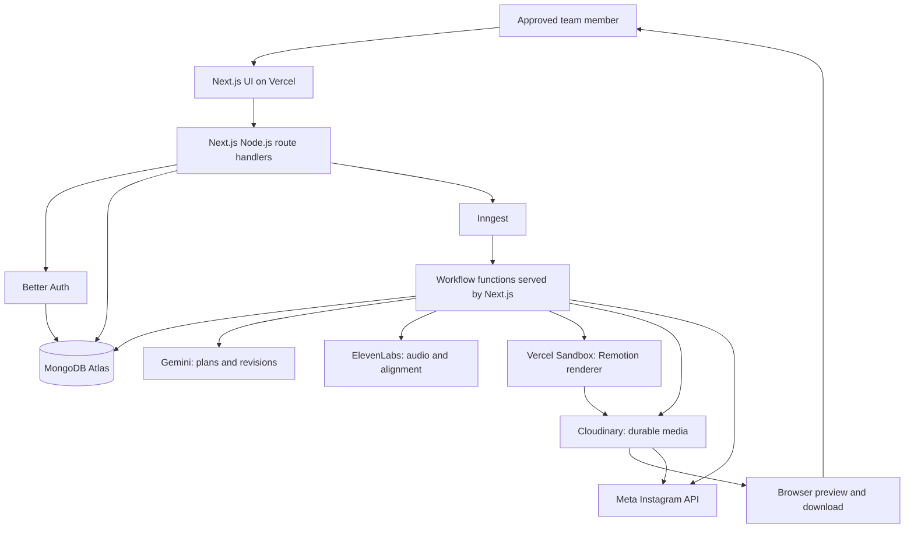
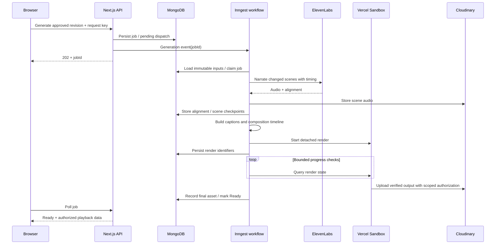

# Sochitra — System Architecture

Version: 1.0  
Date: 2 November 2026  
Status: Proposed implementation architecture for the approved V1  
References: [PRD](PRD.md), [Development roadmap](DEVELOPMENT_ROADMAP.md), [Pipeline status](PIPELINE_STATUS.md)

## 1. Architecture decision

Use one Next.js application with well-separated TypeScript modules. Vercel hosts the interface and Node.js endpoints. Inngest coordinates durable background workflows. Remotion runs inside Vercel Sandbox for hosted rendering. MongoDB Atlas stores application state; Cloudinary stores media.

This is a modular monolith with external managed services, not a collection of independently deployed microservices. No separate Express server, Redis queue, billing service, or custom operations dashboard is needed.

The public website exposes a login page. Only approved team members may use protected application features. V1 projects belong to individual users; shared workspace permissions are not implied by team membership.

## 2. System diagram



Inngest invokes our registered workflow functions through its signed endpoint. Long rendering happens in Sandbox; a normal Vercel request must not remain open for the entire render or a future scheduled post.

## 3. Responsibilities

| Component | Owns | Does not own |
|---|---|---|
| Next.js UI | Four-step journey, forms, video preview, revision chat, status display | Provider credentials or authorization decisions |
| Route handlers | Authentication, approval/ownership checks, validation, durable job acceptance | Full rendering or long sleeps |
| Better Auth | Identity and sessions, using its MongoDB adapter | Project authorization |
| Application services | Revision rules, duration decisions, schedules, asset permissions | Provider-specific transport details |
| Inngest functions | Durable steps, checkpointed orchestration, delayed execution | Application source of truth |
| MongoDB Atlas | Projects, revisions, jobs, assets metadata, connections, publication state | MP3/MP4 file bytes |
| Cloudinary | Audio/video/image delivery and storage | Project state or workflow authority |
| Gemini adapter | Structured script/scene generation and edit proposals | Executable rendering code or publishing decisions |
| ElevenLabs adapter | Narration plus alignment | Finished caption layout or animation direction |
| Timing engine | Caption chunks, cue anchors, scene offsets, frame timing | Content generation |
| Remotion renderer | Trusted React/SVG components and deterministic frames | Arbitrary model-generated code |
| Meta adapter | Official authorization, media processing, publishing, reconciliation | Our scheduling clock |

## 4. User interface and request boundaries

Pages:

- `/login`: public entry point; approved members only after identity verification.
- `/dashboard`: Create video and saved projects.
- `/projects/[id]`: Describe, Review, Generate/refine, Download/publish in a single project workspace.
- `/connections`: Instagram connection state.
- `/account`: basic identity and preferences.

Use server-rendered initial data where practical. Use client components for editable forms, revision chat, progress polling, and video playback. A simple polling loop while a job is active is enough for V1; no WebSocket infrastructure is required. Pause polling when the page is hidden and stop at terminal states.

Remotion Player may show the draft composition for fast local visual previews. The rendered MP4 is the authoritative final preview for download or publication. Draft previews must not be confused with completed renders.

## 5. Authentication and authorization

Use Better Auth with MongoDB Atlas. Proposed initial login method: Google OAuth with verified email and a server-side normalized email allowlist. This avoids adding email-delivery infrastructure for password resets. The OAuth provider choice remains an implementation default to confirm before setup.

Public login does not mean unrestricted registration. Enforce approval during account creation/sign-in and protected actions. A removed member must lose access even if their session remains valid. No approval-management UI is needed initially; owner-maintained configuration is enough.

Every project lookup and mutation includes the authenticated owner ID. Workflow events are internal and carry record IDs; workflow code loads authoritative ownership/state from MongoDB rather than trusting an event's claimed user ID. Reject unapproved owners before new generation or publication side effects.

Better Auth cookies/session checks protect browser-originating calls. Validate request origins and CSRF protections appropriate to the selected authentication flow. Meta OAuth has separate state and callback verification. Do not reuse a login token as an Instagram token.

## 6. Data model

Use MongoDB's native driver in application repositories, Zod at external boundaries, and Better Auth's supported MongoDB adapter for auth collections. Avoid introducing a second ORM for V1.

| Collection | Main fields |
|---|---|
| Better Auth collections | Managed user, account, session, verification records as required by its adapter |
| `projects` | `_id`, `ownerId`, brief, language, audience, target duration, current draft/ready revision IDs, `version`, deletion state |
| `revisions` | Project/owner IDs, parent revision, approved script hash, scene plan, voice/style, composition schema version, renderer version, readiness, timestamps |
| `sceneArtifacts` | Revision/scene IDs, input hash, audio asset ID, normalized alignment, captions, cue times, measured duration |
| `assets` | Owner/project/revision IDs, Cloudinary public ID/version/resource type, media metadata, checksum, provenance/rights status |
| `jobs` | Owner/project/revision IDs, operation, state/stage, attempts, request key, dispatch state, external operation IDs, error code, checkpoints |
| `messages` | Project/revision IDs, role, text, proposed structured edit, application status |
| `changeProposals` | Base revision/version, validated patch, review requirements, clarification/application state |
| `connections` | Owner ID, Instagram account ID, encrypted token data, granted scopes, expiry and health |
| `publications` | Owner/project IDs, pinned revision/asset IDs, account, post caption, UTC schedule/timezone, generation counter, state, provider IDs, dispatch lease |

Keep scene artifacts in separate bounded documents so large alignment payloads do not grow a single project document toward MongoDB's document limit. No media binary data is stored in MongoDB. Large future artifact payloads would require a separate storage decision; do not silently use unlimited embedded arrays.

Required indexes include owner/update-time project listing, project/revision history, job state, and publication due-state lookups. Add a unique `(ownerId, operation, requestKey)` job index, a unique `(revisionId, sceneId, inputHash)` artifact index, and unique operation IDs for external work where available. Retain publication records for reconciliation; do not expire active schedules or pending jobs through TTL indexes.

Ready revisions are immutable. Draft changes use optimistic concurrency (`version`/expected revision) to prevent lost writes. Publishing always pins a ready revision and concrete asset, never a mutable “latest video” URL.

## 7. Application API

All application routes use the Node.js runtime. Validate with Zod and return consistent error codes, safe messages, and request IDs.

| Method/path | Purpose |
|---|---|
| `/api/auth/[...all]` | Better Auth handler |
| `GET/POST /api/projects` | List own projects / create draft |
| `GET/PATCH/DELETE /api/projects/[id]` | Read, autosave with expected version, or delete |
| `POST /api/projects/[id]/ideas` | Request topic suggestions |
| `POST /api/projects/[id]/script` | Queue script generation |
| `POST /api/projects/[id]/generate` | Approve a script revision and queue video generation |
| `POST /api/projects/[id]/revisions` | Queue a conversational change proposal |
| `POST /api/projects/[id]/revisions/[revisionId]/apply` | Apply reviewed changes and queue required regeneration |
| `POST /api/projects/[id]/restore` | Select a previous ready revision |
| `GET /api/jobs/[id]` | Owner-authorized job status |
| `POST /api/jobs/[id]/retry` | Retry a recoverable failed job from valid checkpoints |
| `GET /api/assets/[id]/download` | Authorized download delivery or redirect |
| `GET /api/instagram/connect` | Begin Meta authorization |
| `GET /api/instagram/callback` | Verify OAuth response and persist connection |
| `DELETE /api/instagram/connection` | Disconnect with undispatched-schedule handling |
| `POST /api/publications` | Accept publish-now or scheduled publication |
| `GET/PATCH /api/publications/[id]` | View or reschedule/edit caption before dispatch |
| `POST /api/publications/[id]/cancel` | Cancel if dispatch has not started |
| `/api/inngest` | SDK handler, verified with Inngest signing configuration |

Job-creating requests return `202 { jobId, state }`; repeats using the same request key return the existing job. Stale draft edits return `409`; invalid inputs return `400`; unavailable provider access is an actionable job error. Returning `202` means accepted, not completed.

## 8. Durable job acceptance and dispatch

There is no transaction spanning MongoDB and Inngest. Handle that explicitly:

1. Insert a job with `dispatchState: pending` and a stable request key.
2. Send an Inngest event containing the job ID, using a deterministic event ID supported by the integration.
3. Mark dispatched after acknowledgment. If acknowledgment is lost, the same logical job may be dispatched again; the workflow must tolerate that.
4. A small Inngest recovery function periodically scans old pending dispatch records and retries delivery. A failed event send must not leave a permanently stuck project.
5. Workflow steps check state and claim the job before side effects. MongoDB conditional updates and unique keys are the ultimate guard, beyond any event deduplication window.

This uses existing job records as an outbox; no additional queue service is introduced.

## 9. Generation workflow



Script generation is a separate durable workflow before this sequence: Gemini returns constrained scene data, validation runs, and the user reviews narration. Scene planning may add visual parameters after approval but must not silently rewrite approved speech.

Generate scene audio sequentially at first. Reuse scene artifacts only when narration, voice/model/settings, language, and relevant processing versions match. Verify alignment integrity and measure actual audio duration; the proof currently uses the last speech timestamp, which must be strengthened for production.

Duration fitting happens before expensive rendering. If pacing cannot fit the selected duration, return a script-review action rather than truncating audio or silently changing the explanation.

## 10. Hosted rendering boundary

Use the documented Remotion Vercel integration and Sandbox SDK after verifying compatible versions. Pin the same Remotion version across renderer packages. Bundle known application components and pass validated JSON; never execute model-generated JavaScript.

Sandbox inputs: composition bundle/version, immutable scene data, scoped asset delivery URLs, fonts, and narrowly scoped upload authorization. Sandbox does not need MongoDB, Gemini, ElevenLabs, or Meta credentials.

Start rendering detached from the API lifecycle. Store sandbox/render identifiers and reconcile them before creating another render. Inngest performs short progress checks separated by durable waits; it does not keep an ordinary Vercel function polling indefinitely.

Sandbox output must be durably uploaded to Cloudinary before cleanup. If the Remotion helper only offers another storage backend, implement a scoped Cloudinary upload within the sandbox rather than adding unapproved permanent storage. Validate this transfer in the hosted integration proof.

Use deterministic version-specific Cloudinary public IDs with overwrite disabled. If an upload succeeded but its response was lost, look up the expected asset before uploading again. Only mark Ready after checking duration, dimensions, codec/audio presence, and durable output availability.

Stop sandbox resources after completion or terminal cancellation. Reconcile orphaned renders with persisted jobs. If an expired sandbox lost its temporary output before upload, rerender from preserved inputs and audio; never mark the vanished output ready.

## 11. Conversational editing

Gemini returns a proposed structured patch, not a tool command. Validate allowed operations against the current revision and supported component catalog.

| Edit | Invalidated work |
|---|---|
| Post caption/schedule | Publication metadata only |
| Caption typography or visual layout | Render only |
| Narration text/pronunciation | Affected audio and alignment, downstream offsets, final render |
| Voice or language | All speech/alignment and render; language also changes reviewed text and labels |
| Duration/audience/topic | New reviewed script/scene plan and affected downstream artifacts |

Ask one focused question when ambiguous. New revision jobs cannot overwrite another active mutation; use project-level active-job claiming and revision-version checks. A failed new version leaves the previous ready output available. Undo selects a prior immutable ready revision and does not regenerate it.

## 12. Scheduling and publication

Store schedule time as a UTC instant plus an IANA timezone for display. Inngest uses durable sleep-until execution. The effective maximum scheduling horizon must be below the account's maximum workflow run length with operational margin; the PRD's proposed 30-day cap is subject to that check.

Each reschedule increments `scheduleGeneration`. An event carries publication ID and generation; an old wake-up exits when its generation no longer matches MongoDB. Cancellation signals may stop sleeping workflows, but authoritative state checks remain mandatory.

At dispatch:

1. Atomically claim an eligible scheduled/queued publication, checking generation, owner approval, and pinned ready asset.
2. Validate connection permissions, token health, and current Meta media requirements.
3. Deliver the Cloudinary media URL for the provider's complete ingestion window.
4. Persist the media-container ID; poll processing through bounded durable steps.
5. Submit publication and persist the resulting media ID before reporting Published.
6. On uncertain response, query/reconcile known provider state. Do not blindly submit another publish request.

Exactly-once external publishing cannot be guaranteed by our queue alone. Idempotent local records, provider identifiers, and outcome reconciliation minimize duplicates. Unknown outcomes enter Needs attention rather than pretending success or automatically reposting.

Cancellation and dispatch race through conditional state updates. Once dispatch wins, communicate that cancellation cannot guarantee stopping the post. Late jobs follow the PRD grace-period policy. Changing a video never changes its scheduled revision without explicit replacement.

## 13. Reliability and security

- Treat workflow delivery as repeatable; checkpoint results and make stage transitions conditional.
- Reuse a valid checkpoint on retry. Backoff only transient failures; do not retry invalid credentials or unsupported voices indefinitely.
- A successful provider call can occur before our checkpoint is saved. Without provider-supported idempotency, that window may cause duplicate generation. Persist attempts and classify ambiguous outcomes; do not promise exactly-once charging or generation.
- Give UI states specific meanings: Queued, Preparing, Narrating, Synchronizing, Rendering, Ready, Failed. Publishing has independent states.
- Store provider secrets in server environment configuration. Encrypt Instagram tokens with a server-held key and record encryption version for rotation.
- Use authenticated/restricted Cloudinary delivery for sensitive media. An unguessable public URL is not an authorization mechanism. The proof's public demo uploads are not the production privacy model.
- Validate Inngest endpoint signatures and Meta OAuth state. Protected application actions require approval and owner checks even if the UI hides their buttons.
- Production preview deployments must not dispatch real Instagram posts. Use separate test integration configuration or disable publishing outside the intended production environment.
- Keep simple structured logs containing request/job/stage/error identifiers; exclude credentials and private lesson text. No custom monitoring dashboard or usage ledger.

## 14. Repository organization

Proposed structure when introducing Next.js:

```text
src/
  app/
    login/
    dashboard/
    projects/[id]/
    connections/
    api/
  components/             # Dashboard and creation-flow UI
  server/
    auth/                 # Better Auth and approval checks
    db/                   # MongoDB client, repositories, indexes
    services/             # Projects, revisions, assets, publications
    providers/            # Gemini, ElevenLabs, Cloudinary, Meta
    workflows/            # Inngest functions and events
    rendering/            # Sandbox orchestration and transfer
  core/                   # Shared schemas and pure timeline logic
  video/                  # Remotion compositions and scene components
scripts/                  # Local proof and diagnostics
tests/                    # Timing, authorization, and workflow invariants
```

Server-only modules must not be imported by browser components. Reuse the existing `src/core` and `src/video` work. Extract the CLI's provider calls into adapters; do not invoke the CLI from an API route.

## 15. Environments and deployment

| Environment | Execution |
|---|---|
| Local | Next.js + Inngest Dev Server, local Remotion render; test database/media configuration |
| Vercel preview | Authenticated UI and test workflows; real posting disabled |
| Vercel production | Approved-team UI, Inngest Cloud orchestration, Sandbox rendering, configured provider accounts |

Required configuration groups: Better Auth secret/base URL and selected login provider; approved emails; MongoDB URI/database; Gemini key/model; ElevenLabs key/model/voices; Cloudinary credentials; Inngest event/signing configuration; Vercel Sandbox authentication; Meta application/callback configuration and token encryption key.

Use the SDK's supported deployment authentication mechanism for Sandbox; exact variables depend on the chosen integration and environment. Never copy secrets into committed example files. Render/runtime dependencies and fonts must be packaged deliberately for hosted execution.

Zero spending remains a constraint. Account entitlements, free allowances, provider rights, and runtime limits must be verified before hosted tests. No automatic upgrades. These are setup dependencies rather than additional product screens.

## 16. Build sequence and architecture validation

1. Extract provider adapters and pure orchestration inputs from the existing CLI; preserve the working sample commands.
2. Scaffold Next.js and approved-member Better Auth; add MongoDB repositories and owner checks.
3. Implement one authenticated generation endpoint, durable dispatch, Inngest workflow, and status polling page.
4. Prove detached Sandbox rendering and direct Cloudinary persistence with the existing English/Hindi compositions.
5. Build the four-step interface and revision workflow on these APIs.
6. Implement Meta connection, publication reconciliation, and scheduling.

Validate the architecture with tests for cross-user denial, removed approval, duplicate submissions, event-send failure, restarted renders, successful uploads with lost responses, stale edits, schedule replacement, cancellation races, and uncertain Meta outcomes. Test Hindi shaping and actual rendered audio/timing separately from schema tests.

The current local pipeline is implemented. The web, database, durable orchestration, hosted rendering, and publication design in this document are proposed work until their integration checks pass.

## 17. Official integration references

- [Better Auth Next.js integration](https://better-auth.com/docs/integrations/next)
- [Better Auth installation and adapters](https://better-auth.com/docs/installation)
- [Inngest Next.js integration](https://www.inngest.com/docs/getting-started/nextjs-quick-start)
- [Inngest sleep-until scheduling](https://www.inngest.com/docs/durable-execution/primitives/step-sleepuntil)
- [Inngest workflow primitives and run-length constraints](https://www.inngest.com/docs/durable-execution/primitives)
- [Inngest cancellation](https://www.inngest.com/docs/features/inngest-functions/cancellation/cancel-on-events)
- [Remotion rendering on Vercel Sandbox](https://www.remotion.dev/docs/vercel)
- [Vercel Sandbox](https://vercel.com/docs/sandbox)
- [ElevenLabs speech with timestamps](https://elevenlabs.io/docs/api-reference/text-to-speech/convert-with-timestamps)
- [Meta Instagram API collection](https://www.postman.com/meta/instagram/documentation/6yqw8pt/instagram-api)
